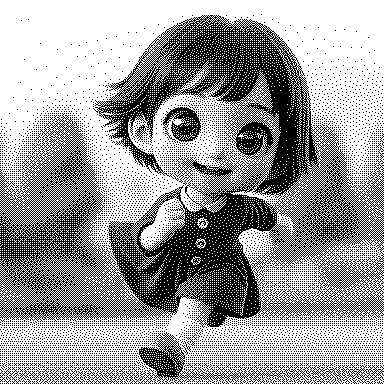

# pic2gray4px

白黒なのに、写真が見える。

`pic2gray4px` は、2×2 の小さなマスに白を何個置くかで 5 段階の明るさを作る Rust 製 CLI です。白点の位置は周囲の見え方を見ながら選びます。さらに、マスごとに丸めたときの端数を隣のマスへ渡すので、広いグラデーションの濃さも残しやすくなりました。できあがるのは、一般的なビューアで開ける **1-bit グレースケール PNG** です。

**▶ ブラウザ版： [https://tanep3.github.io/pic2gray4px/](https://tanep3.github.io/pic2gray4px/)**
インストール不要で、写真を選ぶだけですぐ変換できます。スマホではホーム画面に追加するとアプリとして使えます。他のアプリから写真を「共有」で渡すこともできます。

## 変換前と変換後

| 変換前（カラー） | 変換後（1-bit グレースケール PNG） |
| --- | --- |
|  |  |

どちらも同じ正方形の構図で、384×384 ピクセルです。変換前は元写真を縮小したカラー画像、変換後は元写真を CLI の `--width 384` で直接変換した画像です。縮小の処理方法が異なるため、画素単位で同じ入力を比較したものではありません。

## インストール

プロジェクトのルートで:

```sh
cargo install --path .
```

## 使ってみる

```sh
pic2gray4px photo.jpg
# photo-4px.png ができる
```

T02 など幅 384 ピクセル向けなら:

```sh
pic2gray4px photo.jpg photo-t02.png --width 384
```

入力は PNG、JPEG、WebP、BMP、TIFF、PNM に対応します。画像が奇数寸法なら右端・下端を白で補います。透過部分は白地に重ねます。

既存の出力ファイルは上書きしません。意図して上書きするときだけ `--force` を付けてください。

## 写りを調整する

標準では無補正も含む候補を実際の 4px 画像まで変換し、階調・輪郭・粒状感を元画像と比べてコントラストとアンシャープを選びます。**実際に選んだ値を実行結果に表示**します。白飛び・黒つぶれと変化量には上限を設けています。評価は見た目の近似であり、すべての画像で最良値を保証するものではありません。

```sh
pic2gray4px photo.jpg --contrast 1.08 --unsharp 0.25
pic2gray4px photo.jpg another.png --contrast off --unsharp off
```

`--contrast` は `auto`（標準）、`off`（倍率 1）、または 0〜3。`--unsharp` は `auto`（標準）、`off`（強さ 0）、または 0〜2。自動ではアンシャープ 0〜1.5 を候補に含めます。強い値では輪郭の不自然さやノイズが出ることがあります。

元の VM 実験の「マスごとに白点数を独立に丸める」方式と比べるなら、`--no-diffusion --contrast off --unsharp off` を指定します。`--passes 0..10` は配置を見直す上限回数で、標準は 10 です。

## 変換モード（ディザ／写真／イラスト）

二値化の方式が2つあります。既定の「セル方式」は 2×2 セルの中でドットの並び方を最適化し、構造（顔や輪郭）の読みやすさを守ります。もう1つの「ディザ方式」は画素単位の Floyd–Steinberg 誤差拡散で、局所的な階調の平均を保つため、肌や空のようななめらかな階調が綺麗に出ます。前処理（ミキサー、トーンカーブ、局所コントラスト、コントラスト／シャープネスの自動選択）はどちらの方式にも共通です。

セル方式では、配置を決めた後で隣のマスと白点を融通し合う「セル間白点交換」をかけると、写真では階調が、イラストでは平坦部の綺麗さが上がります。効き方が被写体で違うため、モードとしてまとめました。

```sh
pic2gray4px photo.jpg --mode dither        # Floyd–Steinberg 誤差拡散（階調の忠実さ）
pic2gray4px photo.jpg --mode photo         # 残差拡散＋交換（構造の読みやすさ）
pic2gray4px art.png --mode illustration    # 拡散なし＋交換（平坦部の綺麗さ）
pic2gray4px photo.jpg --exchange 3         # 交換だけを直接指定もできる
```

交換はペアの白点合計を保存するので、全体の階調の帳尻は変わりません。詳しくは [セル間白点交換の要件](docs/exchange-requirements.md) と [設計](docs/exchange-design.md) を参照してください。

詳しくは [要件定義](docs/requirements.md)、[アルゴリズム](docs/algorithm.md)、[システム設計](docs/design.md) を参照してください。

Copyright (c) 2026 Tane Channel Technology. MIT License.
